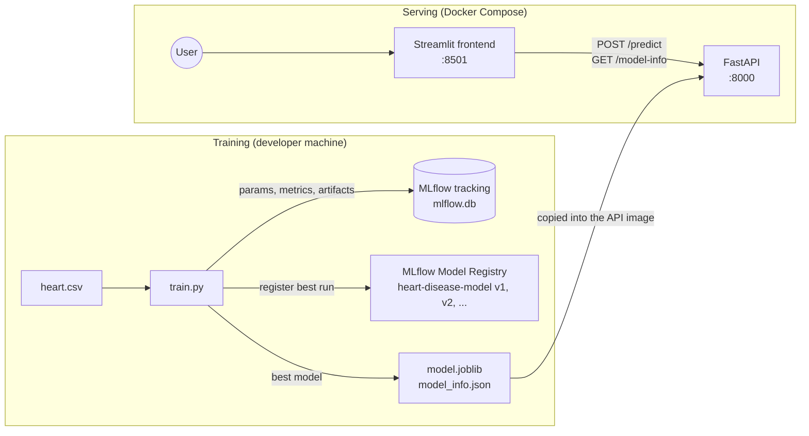

# Heart Disease Prediction: ML System (FastAPI + Streamlit + MLflow + Docker)

A small end-to-end machine learning system built on the Kaggle
[Heart Disease dataset](https://www.kaggle.com/datasets/johnsmith88/heart-disease-dataset)
(`heart.csv`):

- **Training + MLflow**: `train.py` trains several candidate models, tracks every
  run in MLflow (parameters, metrics, model artifacts) and registers the best one
  in the MLflow Model Registry.
- **API**: FastAPI serves the best model (`POST /predict`).
- **Frontend**: a Streamlit page where a user fills in a form and gets a prediction.
- **Docker**: API and frontend run together with Docker Compose.

> Educational project only. Not for medical use.

This is SIS-3, a continuation of Practical Task 6. The Practice 6 version
(model + FastAPI + Docker only) is kept under the
[`practice-6` tag](https://github.com/Syrym275/ml-fastapi-docker/tree/practice-6).

## Architecture



1. `train.py` trains 4 candidate models. Each one is an MLflow **run** inside the
   experiment `heart-disease-prediction`.
2. The best run is registered as **`heart-disease-model`**. Every registration
   creates a new **version** (1, 2, 3, ...), and the alias **`champion`** points at
   the newest best version.
3. The same best model is saved as `model.joblib` together with `model_info.json`
   (registry name, version, run id, metrics). The API loads these files.
4. The Streamlit page sends the form data to the API and shows the answer. It
   never loads the model itself.

## Project structure

```
ml-fastapi-docker/
├── train.py              # trains models, logs to MLflow, registers the best one
├── main.py               # FastAPI app (GET /, GET /model-info, POST /predict)
├── model.joblib          # best model (loaded by the API)
├── model_info.json       # which registry version model.joblib is + its metrics
├── heart.csv             # dataset
├── requirements.txt      # API dependencies (used by the API Docker image)
├── requirements-dev.txt  # everything for local work: API + MLflow + Streamlit
├── Dockerfile            # API image
├── docker-compose.yml    # runs API + frontend together
├── frontend/
│   ├── app.py            # Streamlit page
│   ├── requirements.txt  # frontend dependencies
│   └── Dockerfile        # frontend image
└── README.md
```

`mlflow.db` (MLflow's tracking database) and `mlruns/` (run artifacts) are
created locally by `train.py` and are not committed. Run `python train.py` to
recreate them.

## MLflow: what is tracked

**Experiment:** `heart-disease-prediction`, one run per candidate model.

| Logged | What |
|---|---|
| Parameters | `model_type`, hyperparameters (`C` or `n_estimators`, `max_depth`), `test_size`, `random_state`, `cv_folds`, `n_train_rows`, `n_test_rows` |
| Metrics | `cv_f1` (5-fold cross-validation F1 on the training data), test `accuracy`, `precision`, `recall`, `f1`, `roc_auc` |
| Artifacts | the model in MLflow format (with input signature and example), `model.joblib`, `classification_report.txt` |

**Model Registry:** the best run is registered as `heart-disease-model`. Each run
of `train.py` adds a new version, and the alias `champion` points at the newest
best version. The registered model can be loaded with
`mlflow.sklearn.load_model("models:/heart-disease-model@champion")`.

### Results

Data: 302 unique rows (duplicates dropped), 80/20 stratified split, `random_state=42`.

| Run | CV F1 (train) | Test accuracy | Test precision | Test recall | Test F1 | Test ROC AUC |
|---|---|---|---|---|---|---|
| logistic_regression, C=0.1 | 0.840 | 0.787 | 0.778 | 0.848 | 0.812 | 0.881 |
| logistic_regression, C=1.0 | 0.844 | 0.803 | 0.800 | 0.848 | 0.824 | 0.871 |
| logistic_regression, C=10.0 | 0.839 | 0.787 | 0.778 | 0.848 | 0.812 | 0.868 |
| **random_forest, n_estimators=200, max_depth=5** | **0.852** | 0.770 | 0.788 | 0.788 | 0.788 | 0.867 |

The best model is chosen by **cross-validated F1 on the training data**, not by
the test set. The test set has only 61 rows, so one or two predictions change
its scores a lot. Choosing by test score would also "leak" the test set into the
model choice. The Random Forest has the best CV F1, so it is registered as
version 1 and served by the API.

## How to run

### 1. Install dependencies

```bash
python -m venv .venv
.venv\Scripts\activate          # Windows
# source .venv/bin/activate     # macOS / Linux

pip install -r requirements-dev.txt
```

### 2. Train and track with MLflow

```bash
python train.py
```

This creates the experiment, logs 4 runs, registers the best model and writes
`model.joblib` + `model_info.json`.

### 3. Open the MLflow UI

```bash
mlflow ui --backend-store-uri sqlite:///mlflow.db
```

Open <http://127.0.0.1:5000>:

- **Experiments → heart-disease-prediction**: all runs with their parameters and
  metrics. Select runs and press **Compare** to compare them.
- Open a run → **Artifacts**: the logged model (`model/`), `model.joblib` and
  `classification_report.txt`.
- **Models → heart-disease-model**: registered versions and the `champion` alias.

### 4a. Run API + frontend locally

In two terminals:

```bash
uvicorn main:app --reload
```

```bash
streamlit run frontend/app.py
```

- API docs: <http://127.0.0.1:8000/docs>
- Frontend: <http://localhost:8501>

### 4b. Run API + frontend with Docker Compose

```bash
docker compose up --build
```

- API docs: <http://localhost:8000/docs>
- Frontend: <http://localhost:8501>

Stop with `Ctrl+C`, then `docker compose down`.

The API image can still be built and run alone, as in Practice 6:

```bash
docker build -t heart-api .
docker run -p 8000:8000 heart-api
```

## API endpoints

### `GET /`

```json
{"message": "ML API is running"}
```

### `GET /model-info`

Which registered MLflow model version is served, with its parameters and metrics
(the content of `model_info.json`).

### `POST /predict`

Request body (all 13 fields are required):

```json
{
  "age": 52, "sex": 1, "cp": 0, "trestbps": 125, "chol": 212,
  "fbs": 0, "restecg": 1, "thalach": 168, "exang": 0,
  "oldpeak": 1.0, "slope": 2, "ca": 2, "thal": 3
}
```

Response:

```json
{"prediction": 0, "probability": 0.771}
```

`prediction` is the predicted class, using the same coding as the `target`
column of the dataset. `probability` is the model's probability for that class.
Invalid input (missing fields, values out of range) returns HTTP 422.

Example with curl (macOS / Linux / Git Bash):

```bash
curl -X POST http://127.0.0.1:8000/predict \
  -H "Content-Type: application/json" \
  -d '{"age":52,"sex":1,"cp":0,"trestbps":125,"chol":212,"fbs":0,"restecg":1,"thalach":168,"exang":0,"oldpeak":1.0,"slope":2,"ca":2,"thal":3}'
```

Example with PowerShell:

```powershell
Invoke-RestMethod -Method Post -Uri http://127.0.0.1:8000/predict `
  -ContentType "application/json" `
  -Body '{"age":52,"sex":1,"cp":0,"trestbps":125,"chol":212,"fbs":0,"restecg":1,"thalach":168,"exang":0,"oldpeak":1.0,"slope":2,"ca":2,"thal":3}'
```

## Features

| Field | Meaning |
|---|---|
| age | Age in years |
| sex | 1 = male, 0 = female |
| cp | Chest pain type (0-3) |
| trestbps | Resting blood pressure (mm Hg) |
| chol | Serum cholesterol (mg/dl) |
| fbs | Fasting blood sugar > 120 mg/dl (1 = yes) |
| restecg | Resting ECG result (0-2) |
| thalach | Maximum heart rate achieved |
| exang | Exercise-induced angina (1 = yes) |
| oldpeak | ST depression induced by exercise |
| slope | Slope of the peak exercise ST segment (0-2) |
| ca | Number of major vessels colored by fluoroscopy (0-4) |
| thal | Thalassemia code (0-3) |
